I'm Hisham, a mobile app developer with **4 years of experience building with React Native**.

My interest in technology started with Android rooting and custom ROMs. I wanted to know what was happening beneath the screen — and that curiosity eventually led me into building apps, experimenting with game development, and creating products of my own.

### A few things I enjoy building

| **Mobile development** | **Independent products** | **Game development** |
|:--:|:--:|:--:|
| React Native · TypeScript | Product ideas · Practical tools | Unity · C# |
| Features, interfaces & app architecture | Designing, building & refining | Gameplay experiments & prototypes |

### Things I'm exploring

- Android internals, bootloaders and custom ROMs
- Linux and operating system fundamentals
- Software architecture, performance and the details under the hood

### Find me elsewhere

[Portfolio ↗](https://hishamdev.netlify.app) &nbsp; · &nbsp; [Games on itch.io ↗](https://warpredator.itch.io)

---

<code>stay curious</code> · <code>keep building</code> · <code>look under the hood</code>
